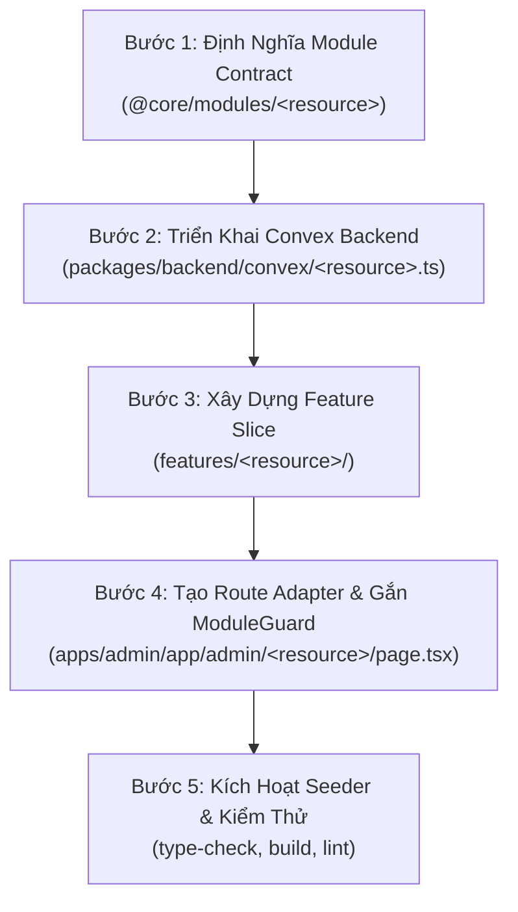

# Cẩm Nang: Hướng Dẫn Thêm Tính Năng Mới (Create New Feature)

Tài liệu này hướng dẫn quy trình 5 bước chuẩn hóa để tạo một module tính năng mới theo kiến trúc **3 Tầng vietadmin-feature-first** trong hệ sinh thái SaaS Monorepo.

---

## Tổng Quan Luồng Thực Hiện



---

## Bước 1: Khai Báo Module Contract Trong `@core`

Tạo file hợp đồng module tại `packages/core/src/modules/<resource>/module.contract.ts`:

```typescript
// packages/core/src/modules/products/module.contract.ts
export const PRODUCT_MODULE_CONTRACT = {
  key: 'products',
  name: 'Quản lý Sản phẩm',
  route: '/admin/products',
  owner: 'features/products',
  actions: ['create', 'read', 'update', 'delete', 'export'] as const,
  features: {
    enableVariants: { default: true, label: 'Biến thể sản phẩm' },
    enableDigitalDelivery: { default: false, label: 'Sản phẩm kỹ thuật số' },
    enableInventoryTracking: { default: true, label: 'Theo dõi tồn kho' },
  },
  fields: {
    sku: { type: 'text', label: 'Mã SKU', required: false },
    compareAtPrice: { type: 'number', label: 'Giá so sánh', required: false },
  },
} as const;

export type ProductModuleContract = typeof PRODUCT_MODULE_CONTRACT;
```
Export contract tại `packages/core/src/modules/index.ts`.

---

## Bước 2: Thiết Kế Schema & Convex Functions

### 2.1. Khai báo Bảng & Chỉ mục trong `packages/backend/convex/schema.ts`
```typescript
import { defineSchema, defineTable } from 'convex/server';
import { v } from 'convex/values';

export default defineSchema({
  products: defineTable({
    tenantId: v.string(),
    name: v.string(),
    slug: v.string(),
    price: v.number(),
    status: v.union(v.literal('draft'), v.literal('published')),
  })
    .index('by_tenant', ['tenantId'])
    .index('by_tenant_and_slug', ['tenantId', 'slug'])
    .index('by_status', ['tenantId', 'status']),

  // Bảng thống kê counter O(1)
  productStats: defineTable({
    tenantId: v.string(),
    totalProducts: v.number(),
    publishedProducts: v.number(),
  }).index('by_tenant', ['tenantId']),
});
```

### 2.2. Khai báo Functions trong `packages/backend/convex/<resource>.ts`
```typescript
// packages/backend/convex/products.ts
import { v } from 'convex/values';
import { query, mutation } from './_generated/server';
import { paginationOptsValidator } from 'convex/server';

export const listPaginated = query({
  args: {
    tenantId: v.string(),
    paginationOpts: paginationOptsValidator,
  },
  handler: async (ctx, args) => {
    return await ctx.db
      .query('products')
      .withIndex('by_tenant', (q) => q.eq('tenantId', args.tenantId))
      .paginate(args.paginationOpts);
  },
});

export const create = mutation({
  args: {
    tenantId: v.string(),
    name: v.string(),
    slug: v.string(),
    price: v.number(),
  },
  returns: v.id('products'),
  handler: async (ctx, args) => {
    const id = await ctx.db.insert('products', {
      tenantId: args.tenantId,
      name: args.name,
      slug: args.slug,
      price: args.price,
      status: 'draft',
    });

    // Cập nhật bộ đếm stats
    const stats = await ctx.db
      .query('productStats')
      .withIndex('by_tenant', (q) => q.eq('tenantId', args.tenantId))
      .unique();

    if (stats) {
      await ctx.db.patch(stats._id, { totalProducts: stats.totalProducts + 1 });
    }

    return id;
  },
});
```

---

## Bước 3: Xây Dựng Feature Domain Slice

Tạo thư mục tính năng tại `features/<resource>/`:

```text
features/products/
├── components/
│   ├── form/
│   │   ├── ProductForm.tsx        # Form nhập liệu React Hook Form + Zod 4
│   │   └── productFormSchema.ts   # Zod validation schema
│   ├── ProductsTable.tsx          # Bảng danh sách sản phẩm
│   └── ProductsFilter.tsx         # Bộ lọc trạng thái / tìm kiếm
├── hooks/
│   └── useProductFilters.ts       # Logic filter URL / state
├── ProductsDashboard.tsx          # Dashboard tổng hợp giao diện chính
├── module.contract.ts             # Re-export contract từ @core
└── index.ts                       # Public barrel export của feature
```

### Triển khai `ProductsDashboard.tsx`:
```tsx
'use client';

import { FC, useState } from 'react';
import { useQuery } from 'convex/react';
import { api } from '@backend/convex/_generated/api';
import { ProductsTable } from './components/ProductsTable';
import { ProductsFilter } from './components/ProductsFilter';
import { Button } from '@ui/components';
import { Plus } from 'lucide-react';

export const ProductsDashboard: FC = () => {
  // Lấy dữ liệu từ Convex
  // const products = useQuery(api.products.list, { ... });

  return (
    <div className="space-y-6 p-6">
      <div className="flex items-center justify-between">
        <div>
          <h1 className="text-2xl font-bold tracking-tight text-slate-900">Sản phẩm</h1>
          <p className="text-sm text-slate-500">Quản lý danh sách sản phẩm và tồn kho.</p>
        </div>
        <Button leftIcon={<Plus className="h-4 w-4" />}>Thêm sản phẩm</Button>
      </div>

      <ProductsFilter />
      <ProductsTable />
    </div>
  );
};
```

---

## Bước 4: Tạo Route Adapter & Gắn `ModuleGuard`

Tạo Server Component tại `apps/admin/app/admin/<resource>/page.tsx`:

```tsx
// apps/admin/app/admin/products/page.tsx
/**
 * @OWNER features/products
 * @TARGET ProductsDashboard
 */
import { ModuleGuard } from '@/shared/components/guards/ModuleGuard';
import { ProductsDashboard } from '@/features/products';

export default async function ProductsPage() {
  return (
    <ModuleGuard module="products" action="read">
      <ProductsDashboard />
    </ModuleGuard>
  );
}
```

> [!WARNING]
> Tuyệt đối không thêm `"use client"` vào file `page.tsx`. Route Adapter bắt buộc là Server Component mỏng để đảm bảo tối ưu bundle và server-side guard.

---

## Bước 5: Kích Hoạt Seeder & Kiểm Thử Hoàn Tất

1. **Đăng ký module vào seeder**: Bổ sung key `<resource>` vào danh sách `adminModules` seeder trong `packages/backend/convex/seeders/adminModules.seeder.ts`.
2. **Chạy các lệnh xác minh**:
   ```bash
   # Kiểm tra kiểu dữ liệu
   pnpm type-check

   # Kiểm tra lint và ranh giới kiến trúc
   pnpm lint

   # Đóng gói thử nghiệm
   pnpm build
   ```
3. Khởi chạy dev server và kiểm tra trực quan trên trình duyệt:
   ```bash
   pnpm dev
   ```
