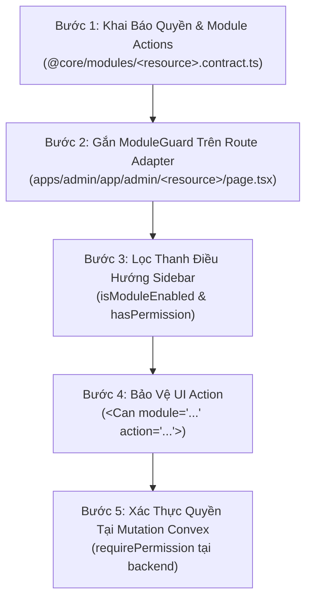

# Cẩm Nang: Triển Khai Phân Quyền & Bảo Vệ Tính Năng (Module RBAC & Guards)

Tài liệu này hướng dẫn chi tiết từng bước áp dụng phân quyền khi **thêm một tính năng mới** hoặc **phân quyền cho vai trò người dùng** trong hệ sinh thái SaaS Monorepo Boilerplate.

---

## Tổng Quan Kiến Trúc Bảo Vệ



---

## Bước 1: Khai Báo Module Actions Trong Contract

Mở file hợp đồng của module tại `packages/core/src/modules/<resource>/module.contract.ts`:
- Khai báo các hành động được hỗ trợ trong mảng `actions`:
```typescript
export const PRODUCT_MODULE_CONTRACT = {
  key: 'products',
  name: 'Sản phẩm',
  route: '/admin/products',
  actions: ['create', 'read', 'update', 'delete', 'export', 'manage'] as const,
  // ...
} as const;
```

Trong bảng `roles` của database Convex, mỗi vai trò sẽ được gán danh sách actions tương ứng:
```typescript
// Dữ liệu mẫu cấu hình trong bảng roles
{
  name: 'Editor',
  permissions: {
    products: ['read', 'create', 'update'],
    posts: ['manage'],
    orders: ['read'],
  }
}
```

---

## Bước 2: Gắn `ModuleGuard` Trên Route Adapter

Mở file Route Adapter tại `apps/admin/app/admin/<resource>/page.tsx`:
- Bọc toàn bộ Dashboard bằng `ModuleGuard` với action `read`:

```tsx
import { ModuleGuard } from '@/shared/components/guards/ModuleGuard';
import { ProductsDashboard } from '@/features/products';

export default async function ProductsPage() {
  return (
    <ModuleGuard module="products" action="read">
      <ProductsDashboard />
    </ModuleGuard>
  );
}
```

> [!NOTE]
> `ModuleGuard` sẽ tự động kiểm tra 2 điều kiện:
> 1. Module `products` có đang được bật (`enabled: true`) trong `adminModules` hay không.
> 2. Người dùng hiện tại có action `read` hoặc `manage` trong danh sách quyền của module `products` hay không.
> Nếu thiếu điều kiện (1) $\rightarrow$ chuyển hướng sang 404. Nếu thiếu điều kiện (2) $\rightarrow$ chuyển hướng sang 403.

---

## Bước 3: Lọc Mục Điều Hướng Trong Sidebar

Trong component `AdminSidebar.tsx`:
- Gắn cờ module tương ứng cho từng mục menu và tự động lọc danh sách menu trước khi render:

```tsx
const navItems = [
  { label: 'Tổng quan', path: '/admin', icon: LayoutDashboard, module: 'dashboard' },
  { label: 'Sản phẩm', path: '/admin/products', icon: Package, module: 'products' },
  { label: 'Đơn hàng', path: '/admin/orders', icon: ShoppingCart, module: 'orders' },
];

// Lọc menu hiển thị
const visibleNavItems = navItems.filter((item) => {
  if (item.module === 'dashboard') return true;
  return isModuleEnabled(item.module) && hasPermission(user, item.module, 'read');
});
```

---

## Bước 4: Bảo Vệ UI Action (Nút Thao Tác & Form)

### 4.1. Sử dụng Component Khai Báo `<Can>`
Bọc các nút thêm, sửa, xóa hoặc kết xuất dữ liệu bằng `<Can>`:

```tsx
import { Can } from '@/shared/components/guards';
import { Button } from '@ui/components';
import { Plus, Trash2 } from 'lucide-react';

export const ProductActions = ({ productId }: { productId: string }) => {
  return (
    <div className="flex items-center gap-2">
      <Can module="products" action="create">
        <Button leftIcon={<Plus className="h-4 w-4" />}>Thêm biến thể</Button>
      </Can>

      <Can module="products" action="delete">
        <Button variant="danger" leftIcon={<Trash2 className="h-4 w-4" />}>
          Xóa
        </Button>
      </Can>
    </div>
  );
};
```

### 4.2. Sử Dụng Hook `usePermission` Trong Logic Sự Kiện
Khi cần kiểm tra quyền trước khi thực thi một hàm JavaScript:

```tsx
import { usePermission } from '@/shared/hooks';

export const ExportButton = () => {
  const { can } = usePermission();

  const handleExport = () => {
    if (!can('products', 'export')) {
      alert('Bạn không có quyền kết xuất dữ liệu sản phẩm');
      return;
    }
    // Thực thi logic export file CSV/Excel
  };

  return <button onClick={handleExport}>Xuất File</button>;
};
```

---

## Bước 5: Kiểm Tra Quyền Tại Tầng Backend Convex

Bảo vệ phía client chỉ mang tính chất trải nghiệm người dùng (UX). Bắt buộc phải xác thực quyền tại Convex mutation:

```typescript
// packages/backend/convex/products.ts
import { mutation } from './_generated/server';
import { v } from 'convex/values';
import { requirePermission } from './auth/permissions';

export const remove = mutation({
  args: { productId: v.id('products') },
  handler: async (ctx, args) => {
    // Ném lỗi Unauthorized nếu người dùng không đủ quyền delete
    await requirePermission(ctx, 'products', 'delete');

    await ctx.db.delete(args.productId);
  },
});
```
