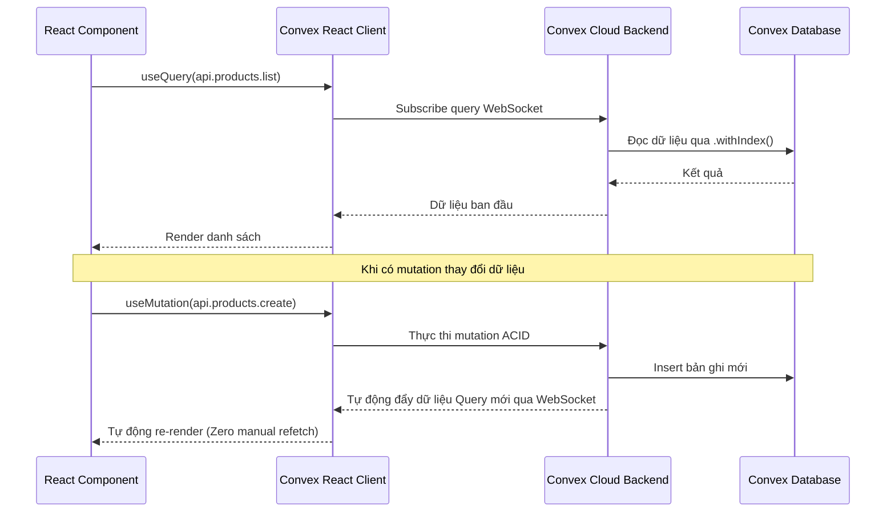

# Cẩm Nang: Quản Lý Luồng Dữ Liệu Convex, Phân Trang & Runtime Config

Tài liệu này hướng dẫn cách kết nối và quản lý dữ liệu máy chủ trong giao diện người dùng sử dụng **Convex React SDK**, thực hiện Optimistic Updates, phân trang theo chỉ mục và đọc cấu hình Runtime Module / Experience UI.

---

## 1. Luồng Dữ Liệu Realtime Của Convex (Reactive Flow)

Khác với Redux Toolkit hay React Query (cần cấu hình invalidate tags thủ công), Convex duy trì kết nối WebSocket liên tục:
- Khi một Client gọi **Mutation** làm thay đổi dữ liệu trong database, Convex sẽ tự động phát hiện các **Query** bị ảnh hưởng và đẩy dữ liệu mới nhất về tất cả các Client đang lắng nghe trong vòng vài mili-giây.



---

## 2. Truy Vấn Dữ Liệu Với `useQuery`

### 2.1. Truy Vấn Cơ Bản & Xử Lý Trạng Thái
```tsx
'use client';

import { useQuery } from 'convex/react';
import { api } from '@backend/convex/_generated/api';
import { Id } from '@backend/convex/_generated/dataModel';

export const ProductDetailView = ({ productId }: { productId: Id<'products'> }) => {
  const product = useQuery(api.products.getById, { productId });

  // 1. Trạng thái Loading (Đang nạp dữ liệu ban đầu)
  if (product === undefined) {
    return <div className="animate-pulse h-32 bg-slate-100 rounded-xl" />;
  }

  // 2. Trạng thái Not Found
  if (product === null) {
    return <div className="text-slate-500">Sản phẩm không tồn tại hoặc đã bị xóa.</div>;
  }

  // 3. Trạng thái Thành Công
  return (
    <div>
      <h2 className="text-xl font-bold">{product.name}</h2>
      <p className="text-emerald-600 font-semibold">{product.price.toLocaleString('vi-VN')} đ</p>
    </div>
  );
};
```

### 2.2. Bỏ Qua Truy Vấn Có Điều Kiện (`'skip'`)
Khi tham số chưa sẵn sàng (ví dụ chưa có `tenantId` hoặc chưa chọn ID):
```tsx
const product = useQuery(
  api.products.getById,
  selectedId ? { productId: selectedId } : 'skip'
);
```

---

## 3. Thay Đổi Dữ Liệu & Cập Nhật Tức Thì (Optimistic Updates)

Để giao diện người dùng phản hồi ngay lập tức trước khi server ghi nhận thành công, sử dụng `.withOptimisticUpdate`:

```tsx
'use client';

import { useMutation } from 'convex/react';
import { api } from '@backend/convex/_generated/api';
import { Id } from '@backend/convex/_generated/dataModel';

export const ToggleProductStatusButton = ({
  productId,
  currentStatus,
}: {
  productId: Id<'products'>;
  currentStatus: 'draft' | 'published';
}) => {
  const updateStatus = useMutation(api.products.updateStatus).withOptimisticUpdate(
    (localStore, args) => {
      // 1. Đọc dữ liệu query hiện tại trong cache cục bộ
      const current = localStore.getQuery(api.products.getById, { productId: args.productId });
      if (current) {
        // 2. Cập nhật ngay lập tức dữ liệu hiển thị trên màn hình
        localStore.setQuery(api.products.getById, { productId: args.productId }, {
          ...current,
          status: args.status,
        });
      }
    }
  );

  const handleToggle = async () => {
    const nextStatus = currentStatus === 'published' ? 'draft' : 'published';
    await updateStatus({ productId, status: nextStatus });
  };

  return (
    <button onClick={handleToggle}>
      {currentStatus === 'published' ? 'Hạ xuống bản nháp' : 'Xuất bản ngay'}
    </button>
  );
};
```

---

## 4. Phân Trang Tối Ưu Với Chỉ Mục (`usePaginatedQuery`)

Khi tải danh sách dữ liệu lớn, bắt buộc dùng phân trang để tránh tải nặng bộ nhớ:

```tsx
'use client';

import { usePaginatedQuery } from 'convex/react';
import { api } from '@backend/convex/_generated/api';
import { Button } from '@ui/components';

export const ProductList = ({ tenantId }: { tenantId: string }) => {
  const { results, status, loadMore } = usePaginatedQuery(
    api.products.listPaginated,
    { tenantId },
    { initialNumItems: 20 }
  );

  return (
    <div className="space-y-4">
      <div className="grid gap-4 sm:grid-cols-2 lg:grid-cols-4">
        {results.map((product) => (
          <div key={product._id} className="p-4 border rounded-xl">
            <h3>{product.name}</h3>
            <p>{product.price} đ</p>
          </div>
        ))}
      </div>

      {status === 'CanLoadMore' && (
        <Button onClick={() => loadMore(20)} variant="outline">
          Tải thêm dữ liệu
        </Button>
      )}

      {status === 'LoadingMore' && (
        <p className="text-center text-sm text-slate-400">Đang tải thêm...</p>
      )}
    </div>
  );
};
```

---

## 5. Đọc Cấu Hình Runtime Module & Experience UI

Trong ứng dụng khách (`apps/site`), giao diện không hardcode mà đọc cấu hình layout từ settings:

```tsx
'use client';

import { useSiteConfig } from '@/shared/hooks/useSiteConfig';
import { useModuleStatus } from '@/shared/hooks/useModuleStatus';

export const ProductActionSection = ({ product }) => {
  // 1. Đọc cấu hình layout trang sản phẩm (được super-admin chỉnh trong /system/experiences)
  const { products_detail_ui } = useSiteConfig();

  // 2. Kiểm tra cờ bật module
  const { isEnabled: isCartEnabled } = useModuleStatus('cart');
  const { isEnabled: isWishlistEnabled } = useModuleStatus('wishlist');

  return (
    <div className="flex items-center gap-3">
      {/* Nút giỏ hàng chỉ hiện khi module cart bật VÀ layout cho phép */}
      {isCartEnabled && products_detail_ui.showAddToCart && (
        <button className="btn-primary">Thêm vào giỏ</button>
      )}

      {/* Nút yêu thích */}
      {isWishlistEnabled && products_detail_ui.showWishlist && (
        <button className="btn-outline">Yêu thích</button>
      )}
    </div>
  );
};
```

