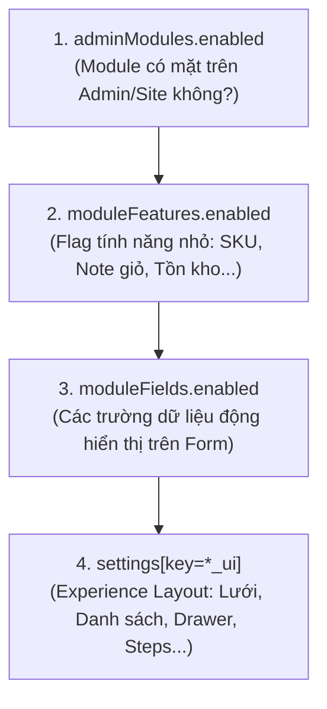

# Quy Tắc Kiến Trúc: Monorepo Boundaries, 3 Tầng Feature-First & Module Runtime

Tài liệu này quy định cấu trúc tổ chức mã nguồn, các ranh giới kiến trúc và cơ chế cấu hình động bắt buộc trong toàn bộ hệ sinh thái **SaaS Monorepo Boilerplate**.

---

## 1. Bản Đồ 3 Vai Trò & Cấu Trúc Monorepo

Hệ thống phân tách rõ rệt 3 vai trò người dùng thành 3 ứng dụng chuyên biệt tại `apps/`, kết hợp các packages lõi tại `packages/`:

```text
apps/
├── site/                     # [Cổng Khách Cuối]
│   └── app/(site)/           # Next.js App Router: Trang chủ, Catalog, Bài viết, Checkout, Đặt lịch, Account
├── admin/                    # [Cổng Quản Trị Tenant]
│   └── app/admin/            # Route Adapters mỏng: Quản lý CRUD nội dung, đơn hàng, khách hàng, settings
└── system/                   # [Cổng Siêu Quản Trị Hệ Thống]
    └── app/system/           # Quản lý Modules, Presets, Experience Layouts, Industry Seeds, System SEO

packages/
├── backend/                  # [Convex Backend & Database Engine]
│   └── convex/               # Schema, Functions (query, mutation, action), Seeders
├── ui/                       # [Technical & Design System Primitives]
│   └── src/                  # Tailwind 4 tokens, Shadcn UI / Radix primitives, cn utility, icons
└── core/                     # [SaaS Core Domain & Contracts]
    ├── modules/              # Module Contracts (module.contract.ts), runtime definitions
    ├── experiences/          # Experience configs (*_ui definitions)
    ├── presets/              # System Presets (blog, landing, catalog, ecommerce...)
    └── types/                # Domain TypeScript Types, Zod Schemas
```

### Ranh Giới 3 Vai Trò & Session
- **Khách cuối (`client` - `apps/site`)**: Thao tác qua session `clientSessions`, dữ liệu bảng `clients`.
- **Nội bộ Tenant (`tenant` - `apps/admin`)**: Thao tác qua session `tenantSessions`, dữ liệu người dùng bảng `tenantUsers` kết hợp RBAC `roles.permissions`.
- **Quản trị SaaS (`superAdmin` - `apps/system`)**: Thao tác qua session `superAdminSessions` (xác thực biến môi trường `SUPER_ADMIN_EMAIL` / `SUPER_ADMIN_PASSWORD`), quản trị tài nguyên cấp cao (không dùng RBAC tenant).
- **Ranh giới bất khả xâm phạm**: Ba nhóm người dùng tách rời hoàn toàn bảng dữ liệu và session; Nhân sự của Tenant không dùng session của Client, và Client không thể truy cập tài nguyên nội bộ của Tenant hay SuperAdmin.

---

## 2. Kiến Trúc 3 Tầng Bắt Buộc (vietadmin-feature-first)

Mọi tính năng trong hệ thống đều tuân thủ nguyên tắc phân tách 3 tầng độc lập:

```text
apps/admin/app/admin/<resource>/page.tsx    [Tầng 1: Route Adapter] - Server Component mỏng
        │  ModuleGuard + params
        ▼
features/<resource>/                       [Tầng 2: Feature Slice] - UI, Form, Hook, Mapper
        │  chỉ gọi Convex API
        ▼
packages/backend/convex/<resource>.ts      [Tầng 3: Convex Backend] - Query, Mutation, Action
```

### 2.1. Tầng 1: Route Adapter (`app/.../<resource>/page.tsx`)
- **Luôn là Server Component mỏng**: Đóng vai trò adapter kết nối URL routing với Feature UI.
- **Quy tắc cấm kỵ**:
  - Cấm khai báo directive `"use client"`.
  - Cấm gọi trực tiếp React hooks (`useState`, `useEffect`, `useQuery`).
- **Nhiệm vụ bắt buộc**:
  - Gắn docblock nhận diện `@OWNER` (feature sở hữu) và `@TARGET` (tên dashboard component).
  - Bọc trang bằng `ModuleGuard` tương ứng để kiểm tra cờ bật module và quyền RBAC.
  - Phân giải URL params/searchParams (nếu có) và truyền xuống component tầng 2.
- **Độ dài chuẩn**: 15 - 40 dòng mã.

```tsx
// apps/admin/app/admin/products/page.tsx
/**
 * @OWNER features/products
 * @TARGET ProductsDashboard
 */
import { ModuleGuard } from '@/shared/components/guards/ModuleGuard';
import { ProductsDashboard } from '@/features/products';

export default async function ProductsPage() {
  return (
    <ModuleGuard module="products" action="read">
      <ProductsDashboard />
    </ModuleGuard>
  );
}
```

### 2.2. Tầng 2: Feature Vertical Slices (`features/<resource>/`)
- Đại diện cho toàn bộ giao diện và logic tương tác của một miền tính năng.
- **Cấu trúc chuẩn của một Feature thư mục**:
  ```text
  features/<resource>/
  ├── components/
  │   ├── form/                # Form tạo/sửa dùng chung (Create/Edit Form)
  │   ├── <Resource>Table.tsx  # Bảng hiển thị danh sách
  │   └── <Resource>Filter.tsx # Thanh tìm kiếm / lọc dữ liệu
  ├── hooks/                   # Custom hooks chuyên biệt của feature
  ├── module.contract.ts       # ⭐ Hợp đồng module (khai báo quyền, route, owner)
  ├── <Resource>Dashboard.tsx  # Component tổng hợp giao diện chính của feature
  └── index.ts                 # Public barrel export duy nhất của feature
  ```
- **Quy tắc độc lập Feature**:
  - **Cấm tuyệt đối import chéo giữa các feature** (ví dụ: `features/orders` cấm import từ `features/products`).
  - Nếu hai feature cần chia sẻ logic UI hoặc hàm mapper, thành phần đó phải được đưa về `packages/core` hoặc `packages/ui`.
  - Mọi tương tác dữ liệu với máy chủ chỉ thông qua Convex client API (`@backend/convex/_generated/api`).

### 2.3. Tầng 3: Convex Backend (`packages/backend/convex/<resource>.ts`)
- Nơi duy nhất xử lý lưu trữ dữ liệu, mutation, logic nghiệp vụ máy chủ và tích hợp bên thứ ba.
- **100% Type-Safe Validators**: Bắt buộc khai báo đầy đủ `args` và `returns` validator sử dụng `v` từ `convex/values`.
- **Phân tách hàm**:
  - `query` / `mutation`: Thao tác trực tiếp với Database theo cơ chế giao dịch ACID.
  - `action`: Chỉ dùng khi cần gọi API bên ngoài, I/O mạng hoặc tính toán nặng không thể chạy trong môi trường mutation thuần.
  - Sử dụng `internalQuery`, `internalMutation`, `internalAction` cho các tác vụ nội bộ hệ thống.
- **Tối ưu hóa Index**: Mọi thao tác tìm kiếm, lọc, phân trang bắt buộc chạy qua chỉ mục `.withIndex()`. Cấm gọi `.collect()` không giới hạn trên các bảng dữ liệu lớn.

---

## 3. Hệ Thống Module Runtime & Experience UI Động

Hệ thống không hardcode giao diện hay tính năng cố định mà điều phối qua **4 cấp độ kiểm soát**:



1. **`adminModules.enabled`**: Trạng thái kích hoạt của module (ví dụ: tắt `promotions` thì toàn bộ menu, route và nút liên quan đến voucher sẽ ẩn).
2. **`moduleFeatures.enabled`**: Bật/tắt tính năng con trong module (ví dụ: module `products` có cờ con `enableVariants`, `enableDigitalDelivery`).
3. **`moduleFields.enabled`**: Quy định trường dữ liệu động nào được hiển thị trên form quản trị và giao diện khách.
4. **`settings[key=*_ui]` (Experience UI)**: Super admin cấu hình layout hiển thị của từng trang thông qua trang `/system/experiences`. Giao diện public đọc qua hook `useSiteConfig()` để dựng layout động mà không cần deploy lại mã nguồn.

> [!IMPORTANT]
> **Quy tắc điều kiện AND**:
> Các nút thao tác hoặc badge trên giao diện Site công khai (như Thêm vào giỏ, Đặt lịch hẹn, Yêu thích) bắt buộc phải kiểm tra điều kiện logic `AND` giữa module trạng thái và cấu hình experience (ví dụ: Nút giỏ hàng yêu cầu cả module `cart` lẫn module `orders` đều ở trạng thái `enabled`).

---

## 4. Presets Hệ Thống & Industry Seed Templates

Để phục vụ triển khai đa ngành nhanh chóng trên một nền tảng:

1. **System Presets (`systemPresets`)**: Các gói cấu hình bật sẵn tổ hợp module tương ứng với mô hình kinh doanh:
   - `blog`: Module bài viết, bình luận, media.
   - `landing`: Trang giới thiệu, liên hệ, form thu thập khách hàng.
   - `catalog`: Trưng bày sản phẩm/dịch vụ, không bật giỏ hàng.
   - `ecommerce-basic`: Catalog + Giỏ hàng + Đặt hàng tối thiểu.
   - `ecommerce-full`: Đầy đủ Voucher, Yêu thích, Bình luận, Đánh giá sản phẩm.
   - *Core Modules luôn bật*: `users`, `settings`.
2. **Industry Templates (`lib/seed-templates/industries/` hoặc `@core/seed-templates`)**: Bộ dữ liệu mẫu khởi tạo theo từng ngành kinh doanh (Thời trang, F&B, Sức khỏe, Bất động sản, Giáo dục...) gồm danh mục, sản phẩm, bài viết và assets demo.

---

## 5. Ranh Giới Monorepo & Quy Chuẩn Path Alias (SSOT)

Mọi thành phần trong mã nguồn phải tuân thủ nguyên tắc **Nguồn Chân Lý Duy Nhất (Single Source of Truth)**:

### 5.1. Phân Hệ Packages
- **`@ui/*` (`packages/ui`)**: Chứa primitives UI không mang nghiệp vụ (`Button`, `Dialog`, `Input`, `Badge`, `Card`, tiện ích `cn`).
- **`@backend/*` (`packages/backend`)**: Chứa Convex schema, API functions, generated API types (`@backend/convex/_generated/api`).
- **`@core/*` (`packages/core`)**: Chứa contracts của module, hệ thống presets, cấu hình experience, zod schemas dùng chung và TypeScript domain entities.

### 5.2. Cấm Tuyệt Đối Proxy / Backward-Compatibility Re-export
1. **Không tạo file Proxy**: Cấm tạo các file trung gian chỉ nhằm import rồi `export *` lại từ package khác.
2. **Không giữ Shim tương thích ngược**: Khi một component, hook hay type được di chuyển hoặc đổi tên, lập trình viên bắt buộc cập nhật toàn bộ các file liên quan trỏ trực tiếp về đường dẫn gốc mới.
3. **Cấm import chéo giữa các Apps**: `apps/site`, `apps/admin` và `apps/system` là 3 ứng dụng độc lập, tuyệt đối không import chéo mã nguồn lẫn nhau.

### 5.3. Quy Tắc Độ Sâu Đường Dẫn Tương Đối
- Chỉ cho phép `./` (cùng thư mục) hoặc tối đa **1 cấp** `../` (thư mục cha trực tiếp) cho quan hệ nội bộ cục bộ.
- **Cấm tuyệt đối** dùng `../../` hoặc sâu hơn (`../../../`). Khi cần nhảy cấp, bắt buộc dùng **Path Alias** chuẩn (`@/*`, `@ui/*`, `@backend/*`, `@core/*`).
