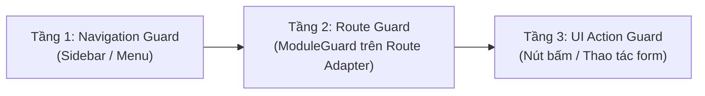

# Quy Tắc Phân Quyền & Bảo Mật: 3 Sessions, Module RBAC & ModuleGuard

Tài liệu này quy định kiến trúc phân quyền chuẩn mực, cách phân tách session và 3 tầng bảo vệ bắt buộc trong toàn bộ hệ sinh thái **SaaS Monorepo Boilerplate**.

---

## 1. Phân Tách 3 Nhóm Session Độc Lập

Hệ thống thiết lập ranh giới bảo mật cứng giữa 3 nhóm người dùng thông qua 3 bảng lưu trữ session riêng biệt:

```text
Khách Cuối (Client)          Nội Bộ Tenant (Tenant)           Quản Trị SaaS (SuperAdmin)
apps/site                    apps/admin                       apps/system
──────────────────────────────────────────────────────────────────────────────
clientSessions               tenantSessions                   superAdminSessions
(bảng: clients)              (bảng: tenantUsers + roles)      (env: SUPER_ADMIN_EMAIL/PASSWORD)
Xem catalog, mua hàng,       CRUD nội dung, đơn hàng,         Bật/tắt module, preset,
đặt lịch, giỏ hàng           phân quyền RBAC nội bộ           seed dữ liệu, experience UI
```

> [!IMPORTANT]
> **Ranh Giới Bất Khả Xâm Phạm**:
> - Tài khoản `tenantUsers` của Tenant không dùng session của Khách hàng (`clients`).
> - Khách hàng (`clients`) không thể truy cập bất kỳ route hoặc API nào thuộc về Tenant hay SuperAdmin.
> - Cổng Super Admin `/system` không sử dụng bảng `roles` của Tenant mà xác thực trực tiếp qua cơ chế `superAdminSessions`.

---

## 2. Mô Hình Phân Quyền Tenant RBAC (Module + Action Matrix)

Trong phạm vi Admin Tenant (`apps/admin`), phân quyền cho người dùng (`tenantUsers`) được tổ chức linh hoạt theo ma trận **Module + Hành động**:

```typescript
// Cấu trúc permissions lưu trữ trong bảng `roles`
export type ModuleKey =
  | 'products'
  | 'orders'
  | 'posts'
  | 'clients'
  | 'settings'
  | 'promotions'
  | 'media';

export type ActionKey = 'create' | 'read' | 'update' | 'delete' | 'export' | 'manage';

export interface RolePermissions {
  permissions: Record<ModuleKey, ActionKey[]>;
}
```

### Nguyên Tắc Phân Quyền:
- **Default Deny**: Mọi quyền không được liệt kê tường minh trong mảng `actions` của module đều bị từ chối truy cập.
- **Action `manage`**: Đại diện cho quyền toàn năng trên module đó (bao gồm toàn bộ `create`, `read`, `update`, `delete`, `export`).

---

## 3. Ba Cấp Độ Bảo Vệ Bắt Buộc (3-Layer Defense System)

Mọi tính năng trong Admin Tenant đều phải được bảo vệ đồng thời ở 3 tầng:



### Tầng 1: Navigation Guard (Thanh Điều Hướng Menu)
- Mọi mục menu trong Sidebar phải liên kết với một `module` cụ thể.
- Menu chỉ hiển thị khi thỏa mãn đồng thời:
  1. `adminModules[item.module].enabled === true` (Module đang được bật ở cấp tenant).
  2. Người dùng có quyền `read` hoặc `manage` đối với module đó:
  ```typescript
  const visibleNavItems = navItems.filter(
    (item) => isModuleEnabled(item.module) && hasPermission(user, item.module, 'read')
  );
  ```

### Tầng 2: Route Guard (`ModuleGuard` Tại Route Adapter)
- Mọi Route Adapter (`apps/admin/app/admin/<resource>/page.tsx`) bắt buộc phải được bọc trong component `ModuleGuard`:
  ```tsx
  import { ModuleGuard } from '@/shared/components/guards/ModuleGuard';
  import { ProductsDashboard } from '@/features/products';

  export default async function ProductsPage() {
    return (
      <ModuleGuard module="products" action="read">
        <ProductsDashboard />
      </ModuleGuard>
    );
  }
  ```
- **Hành vi xử lý của `ModuleGuard`**:
  - Nếu module bị vô hiệu hóa (`enabled: false`): Điều hướng sang trang 404 (Not Found) để ẩn hoàn toàn sự tồn tại của tính năng.
  - Nếu module đang bật nhưng người dùng không có quyền: Điều hướng sang trang 403 (Forbidden).

### Tầng 3: UI Action Guard (Nút Thao Tác & Form)
- **Cấm kiểm tra trực tiếp theo Role**: Tuyệt đối không viết `if (user.role === 'ADMIN')` để ẩn nút; luôn kiểm tra theo cặp `module` và `action`.
- Sử dụng component khai báo `<Can>` hoặc hook `usePermission`:
  ```tsx
  import { Can } from '@/shared/components/guards';
  import { Button } from '@ui/components';
  import { Plus } from 'lucide-react';

  export const ProductToolbar = () => (
    <Can module="products" action="create">
      <Button leftIcon={<Plus className="h-4 w-4" />}>
        Thêm sản phẩm mới
      </Button>
    </Can>
  );
  ```

---

## 4. Bảo Vệ Tại Tầng Backend Convex

- Không chỉ kiểm tra quyền ở giao diện frontend; mọi mutation Convex đều phải xác thực session và phân quyền:
```typescript
// packages/backend/convex/products.ts
import { mutation } from './_generated/server';
import { v } from 'convex/values';
import { requirePermission } from './auth/permissions';

export const create = mutation({
  args: {
    name: v.string(),
    price: v.number(),
  },
  handler: async (ctx, args) => {
    // Xác thực session người dùng và quyền hạn
    const user = await requirePermission(ctx, 'products', 'create');

    return await ctx.db.insert('products', {
      tenantId: user.tenantId,
      name: args.name,
      price: args.price,
      status: 'draft',
    });
  },
});
```
